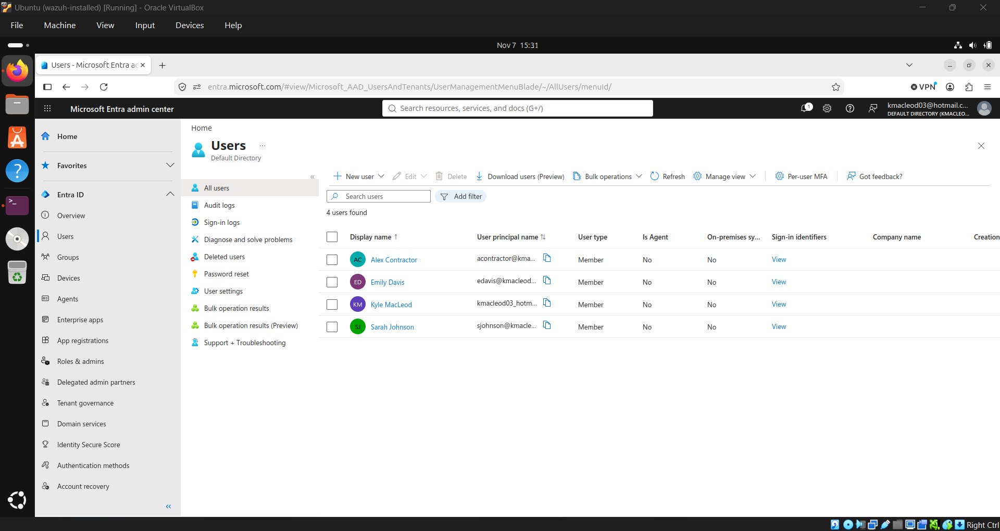
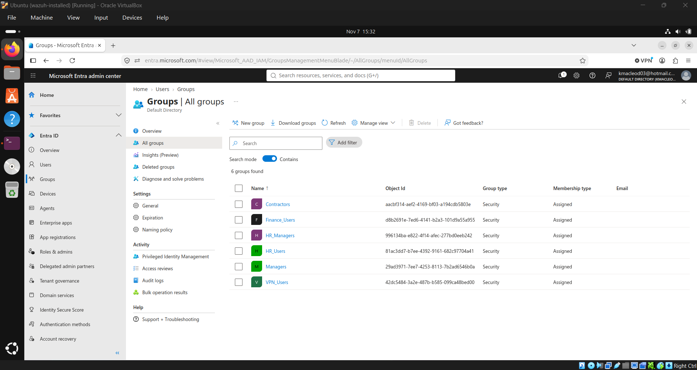
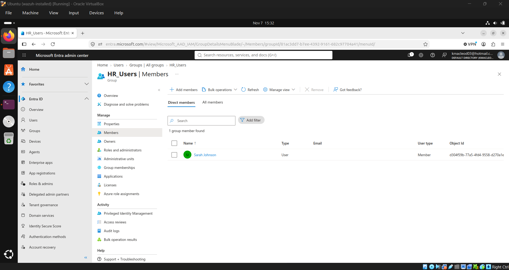

# IAM Lab - Microsoft Entra ID

## Overview

This project demonstrates Identity and Access Management (IAM) concepts using Microsoft Entra ID.

The lab was built to gain hands-on experience with:

- User provisioning
- Group administration
- Identity lifecycle management
- Role-Based Access Control (RBAC)
- Least privilege principles
- Access governance fundamentals

## Environment

| Component | Purpose |
|-----------|----------|
| Microsoft Entra ID | Identity Provider |
| Microsoft 365 Developer Tenant | Lab Environment |
| Security Groups | Access Management |
| Cloud User Accounts | Identity Objects |

## Skills Demonstrated

- User Provisioning and Deprovisioning
- Group Administration
- Role-Based Access Control (RBAC)
- Least Privilege
- Identity Lifecycle Management
- Access Governance
- Microsoft Entra ID Administration
- Cloud Identity Management

## Lab Objectives

The goal of this lab was to understand how organizations manage user identities and access through Microsoft Entra ID.

Key areas of focus included:

- Creating and managing user accounts
- Creating role-based security groups
- Assigning users to appropriate groups
- Understanding access management workflows
- Applying least privilege concepts

## User Management

Multiple user accounts were created to simulate a small business environment:

- Kyle MacLeod
- Emily Davis
- Sarah Johnson
- Alex Contractor

This demonstrated common IAM activities such as onboarding, user administration, and account management.

## Group Management

Security groups were created to represent organizational departments and business functions:

- HR_Users
- HR_Managers
- Finance_Users
- VPN_Users
- Managers
- Contractors

These groups were used to organize access assignments and enforce role-based access control principles.

## Access Administration

Users were assigned to groups based on their business responsibilities.

This exercise demonstrated:

- Role-Based Access Control (RBAC)
- Least Privilege access
- Separation of duties
- Group-based access management

## Screenshots

### User Administration

### Group Administration

### Group Membership Management

## Lessons Learned

Through this project I gained practical experience with:

- User provisioning workflows
- Group-based access management
- Microsoft Entra ID administration
- Identity governance concepts
- Enterprise IAM practices
- Access control fundamentals

## Future Enhancements

- Multi-Factor Authentication (MFA)
- Conditional Access Policies
- Administrative Role Assignments
- Privileged Identity Management (PIM)
- Access Reviews
- Single Sign-On (SSO)
- Identity Governance Workflows

## Career Relevance

This lab supports practical knowledge commonly used in:

- IAM Analyst
- Identity Administrator
- Access Management Analyst
- Security Analyst
- Microsoft Entra ID Administrator
- Governance, Risk, and Compliance (GRC) roles
